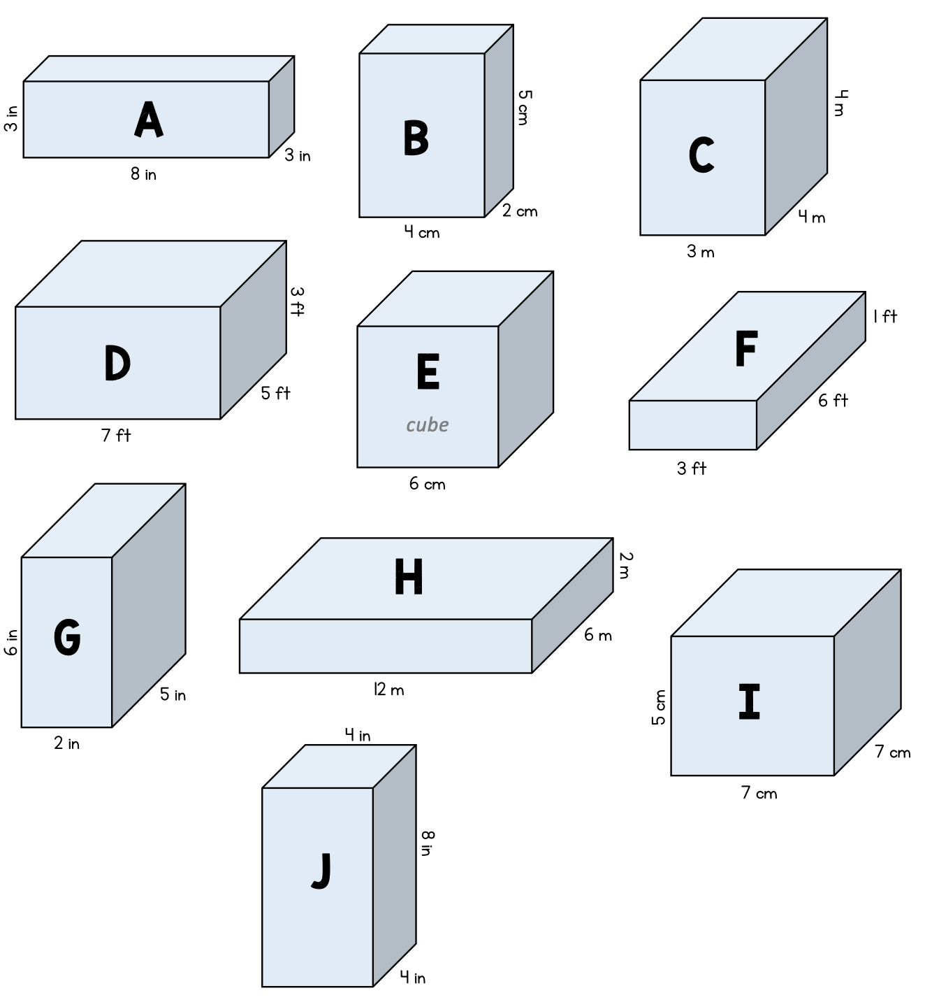

# Generador de prismas

**Demo:** https://1382308.github.io/cube-prism-gen/

Herramienta web para dibujar prismas rectangulares (opcionalmente divididos en cubos unitarios) en proyección oblicua, con estilo normal o "a mano", y exportarlos como PNG (fondo transparente) o SVG.

## Uso

Abre `index.html` en el navegador. No necesita instalación ni servidor: todo (incluidas las librerías en `lib/`) está en el repositorio.

- **Ancho / Alto / Profundidad**: dimensiones del prisma (1–20).
- **Unidad**: mm, cm, dm, m o km.
- **Dibujar en cubos**: muestra la cuadrícula de cubos unitarios.
- **Estilo a mano**: trazo tipo boceto (Rough.js + Excalifont).
- **Letra central**: etiqueta opcional en el centro.
- **Exportar PNG / SVG**: descarga la figura.

## Publicar en GitHub Pages

1. En el repositorio, ve a **Settings → Pages**.
2. En **Build and deployment**, elige **Source: Deploy from a branch**.
3. Selecciona la rama `main` y la carpeta `/ (root)`, y pulsa **Save**.
4. En uno o dos minutos la página estará en `https://<usuario>.github.io/cube-prism-gen/`.

## Créditos

- [Rough.js](https://roughjs.com/) (MIT)
- [Excalifont](https://github.com/excalidraw/excalidraw) (OFL)
